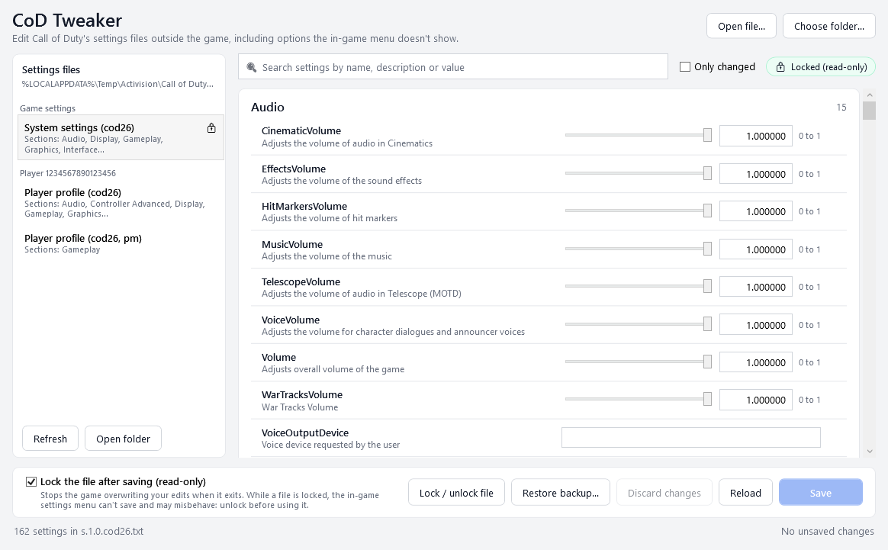

This tool is free, and will always be free. If you appreciate my effort and work, you can tip me here

<a href='https://ko-fi.com/R4B729C84N' target='_blank'></a>

# CoD Tweaker

Edit Call of Duty's settings files outside the game, including the options the in-game menu doesn't show, and keep your changes in place when the game tries to overwrite them.



*Also in [dark](docs/screenshot-dark.png).*

Call of Duty keeps its settings in plain text files under `%LOCALAPPDATA%\Activision\Call of Duty\players`. They hold everything the menus offer plus a good deal they don't: render worker threads, video-memory share, frame-generation modes, dynamic-resolution targets, shader-preload behaviour, blood and corpse limits, menu FPS caps and more. Editing them by hand works, but the game rewrites the files when it exits, so edits vanish unless something puts them back. CoD Tweaker handles all of that.

## What it does

- **Finds the files** by what's inside them, not by name: the system settings (`s.1.0.cod26.txt` today; the numbers change with builds and games), each player's profile files for every account on the PC, the `options.4.codNN.txt` files of the 2022-2024 games, and any copies you've made yourself.
- **Shows every setting** with the game's own description and limits: sliders for numbers, dropdowns for choices, checkboxes for on/off, text for the rest. Values the game detects itself ("DO NOT MODIFY") are shown but not editable.
- **Notes and a "Not in the in-game menu" tag** on the settings worth knowing about, with suggested values where there is a sensible one. The **Not in the menu** filter shows just those.
- **Search** across names, descriptions, notes and values. **Only changed** and **Only pinned** narrow the list.
- **Saves exactly**: only the values you changed are rewritten. Comments, order, line endings, everything else stays byte for byte as the game wrote it.
- **Notices when the game wrote the file** while you had it open, and asks before saving over it. **Show what changed** lists exactly which values the game altered; **Reload, keep my edits** puts your pending edits back on top of the new file.
- **Compare** the open file with any backup, any other settings file or a preset, value by value, and **Take** the ones you want.
- **Presets**: export your values to a JSON file and apply them again later, after a season renamed the file, on another PC, or from a script. Values are matched by name, so changed key hashes don't matter.
- **Backs up before every save** (`%LOCALAPPDATA%\CoDTweaker\backups`, the newest 30 per file are kept), with **Restore a backup** to go back.
- Two ways to keep the game from undoing your work:
  - **Lock the file after saving** makes it read-only. Simple and absolute, but the in-game settings menu can't save while a file is locked and may misbehave.
  - **Guard pinned settings** (recommended): pin the settings you care about, and the app keeps running in the tray, unlocks pinned files while the game runs so its menu works, and writes just the pinned values back when the game exits. Everything else the game saved is kept.
- **Lock all / unlock all** game files in one click, for the times you want the in-game menu.
- Warns when the game is running, since it only reads these files at startup.
- **Light and dark**: follows your Windows setting, or pick one with the button in the corner.
- Tells you when a newer release is out (once this repository is public), and remembers your window size.

## Use it

1. Download `CoDTweaker.exe` from the [latest release](../../releases/latest) and run it. Nothing to install, no admin rights needed. (The `-small-needs-dotnet10` build is a fraction of the size but needs the [.NET 10 Desktop Runtime](https://dotnet.microsoft.com/download).)
2. Pick a file on the left. Change what you like; changed rows get an orange mark and an undo button.
3. Click **Save** (or Ctrl+S).
4. Keep the changes in place with one of the two methods below, then start the game.

> **Windows SmartScreen** may warn that the app is unrecognised, because it isn't code-signed. Click *More info > Run anyway*. The source is here if you'd rather build it yourself (see below).

### Pins and the Guard

Click the pin on a row to pin that value. With **Guard pinned settings** ticked, the app stays in the tray when you close the window; when Call of Duty starts it unlocks any pinned file so the in-game menu keeps working, and a few seconds after the game exits it writes the pinned values back, backing the file up first and keeping whatever else the game changed. A pin shown in orange means the file currently holds a different value than the pin; the Guard will fix that at the next game exit, or use **More > Put pinned values back now** to do it immediately.

Right-click the tray icon to open the window, toggle the Guard, or exit. Start the app with `--tray` (for a shortcut in your Startup folder) to begin hidden.

### Locked files and the in-game menu

While a settings file is locked, the game can't save to it. On some builds that makes the graphics menu misbehave, up to kicking you out of the match when you open it. If you want to use the in-game settings menu, use **More > Unlock all game files** first, make your changes in the game, then lock again. Or switch to pins and the Guard, which handle this for you.

### Compare, presets and scripts

**More > Compare** opens the open file next to any of its backups, another file, or a preset; every difference gets a **Take** button, and taken values become pending changes you then Save. The same window opens from the "changed on disk" banner, so you can see exactly what the game altered after a session.

**More > Export preset** writes the file's values (all of them, or only the pinned ones) to a JSON file. **Apply a preset** opens it in the compare window. From a script, use:

```
CoDTweaker.exe --apply my-preset.json [--file "path\to\s.1.0.cod26.txt"] [--players folder] [--lock | --unlock] [--dry-run]
```

Without `--file` the preset is applied to every matching game file (same game, same kind) in the players folder. Nothing is shown; the result is printed to the console when started from one and always written to `%LOCALAPPDATA%\CoDTweaker\logs`. Exit code 0 means applied (or nothing to change), 1 an error, 2 no matching file.

### Where to find things

| | |
|---|---|
| Game settings files | `%LOCALAPPDATA%\Activision\Call of Duty\players` (older games: `Documents\Call of Duty\players`) |
| Backups made by this app | `%LOCALAPPDATA%\CoDTweaker\backups` |
| Pinned settings | `%LOCALAPPDATA%\CoDTweaker\pins.json` |
| This app's preferences | `%LOCALAPPDATA%\CoDTweaker\settings.json` |
| Crash and apply logs | `%LOCALAPPDATA%\CoDTweaker\logs` |
| Your own setting notes | `%LOCALAPPDATA%\CoDTweaker\notes.json` (same shape as [the built-in list](src/CoDTweaker/Resources/notes.json); entries there override it) |

If the game's folder is somewhere unusual, use **Choose folder...**, or start the app with `CoDTweaker.exe --players "D:\path\to\players"`. **Open file...** opens any file in the same format.

## Building it yourself

Needs the [.NET 10 SDK](https://dotnet.microsoft.com/download).

```
dotnet build CoDTweaker.slnx -c Release
dotnet test
```

To make the single-file exe that the releases ship:

```
dotnet publish src/CoDTweaker/CoDTweaker.csproj -c Release -r win-x64 --self-contained -p:PublishSingleFile=true -p:IncludeNativeLibrariesForSelfExtract=true -p:EnableCompressionInSingleFile=true -o publish
```

Releases are built by GitHub Actions: push a tag such as `v1.3.0` and both exes are attached to a release automatically. Every build also starts the published exe and takes a screenshot, so a build that cannot open its window never ships.

## FAQ

**Can this get me banned?** The app changes the same text files the game's own menu writes, nothing else: no injection, no memory edits, no game files. Still, it isn't made or endorsed by Activision, so use it at your own risk.

**A setting I changed had no effect.** Some values are overridden by the game at startup or depend on others (for example DLSS options only apply when DLSS is the upscaler). After a session, the "changed on disk" banner and **Show what changed** tell you exactly what the game kept and what it reverted.

**The game reset everything.** That happens when the game can't read the file or finds a value it doesn't understand, and also when it detects new hardware or a new driver (see the `DisableHWChangeDetection` note). Use **Restore a backup** to get your version back.

**The notes say "Not in the in-game menu" but I can see it in the menu.** The list is a starting set written against the current game. Corrections are welcome; you can also fix it locally with your own `notes.json` (see the table above).

**Something crashed.** A file in `%LOCALAPPDATA%\CoDTweaker\logs` has the details; your settings files are never touched by a crash.

## Disclaimer

Not affiliated with or endorsed by Activision. Call of Duty is a trademark of Activision Publishing, Inc. Provided as is, without warranty. See [LICENSE](LICENSE).
